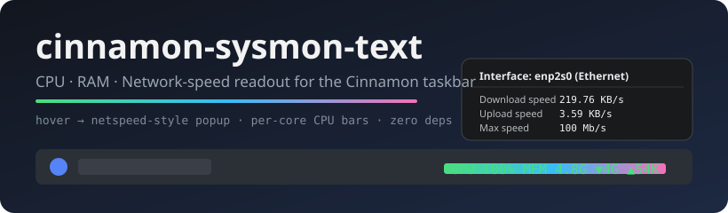
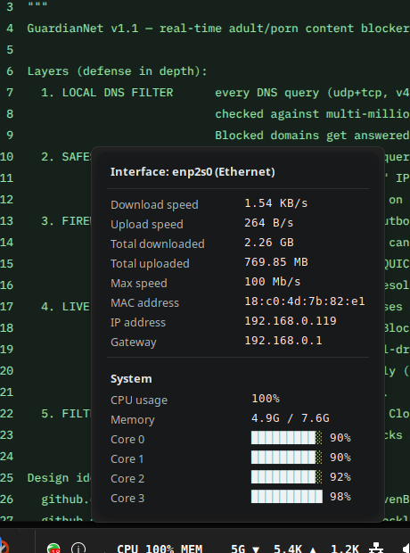

<div align="center">
  

  # ⏱️ ⚡ cinnamon-sysmon-text

  **Realtime CPU · RAM · Network-speed readout applet for the Linux Mint (Cinnamon) taskbar — with a netspeed-style hover popup.**

  [](https://cinnamon-spices.linuxmint.com/)
  [](https://linuxmint.com)
  [](LICENSE)
  [](https://github.com/NurMohammadDuari/cinnamon-sysmon-text/releases/latest)
  [](https://github.com/NurMohammadDuari/cinnamon-sysmon-text/stargazers)
  [](https://github.com/NurMohammadDuari/cinnamon-sysmon-text/issues)
  [](https://github.com/NurMohammadDuari/cinnamon-sysmon-text/actions/workflows/lint.yml)

</div>

---

## 📋 What is this?

A **zero-dependency system monitor applet** for the **Cinnamon taskbar (panel)** that always shows:

| Field | Source |
|---|---|
| `CPU` | total usage %, sampled live from `/proc/stat` |
| `MEM` | used memory from `/proc/meminfo` |
| `▼ / ▲` | download & upload rates from `/proc/net/dev` |

…right inside the taskbar text:

```
CPU 100%  MEM 4.8G ▼ 4G ▲ 54K
```

Hover (or click) the text and a **netspeed-style dark card popup** appears above the panel —
the same layout as the popular `netspeed` app — with **live per-core CPU bars**:

```
┌─────────────────────────────────────────┐
│ Interface: enp2s0 (Ethernet)            │
│ ─────────────────────────────────────── │
│ Download speed        219.76 KB/s       │
│ Upload speed          3.59 KB/s         │
│ Total downloaded      2.23 GB           │
│ Total uploaded        466.53 MB         │
│ Max speed             100 Mb/s          │
│ MAC address           18:c0:4d:7b:82:e1 │
│ IP address            192.168.0.119     │
│ Gateway               192.168.0.1       │
│ ─────────────────────────────────────── │
│ System                                  │
│ CPU usage             100%              │
│ Memory                4.9G / 7.6G       │
│ Core 0  ████████████ 92%                │
│ Core 1  ████████████ 98%                │
│ Core 2  ████████████ 94%                │
│ Core 3  ████████████ 94%                │
└─────────────────────────────────────────┘
```

**Real screenshots of it running** (Linux Mint 22, Cinnamon 6.6):

<p align="center">
  
  &nbsp;&nbsp;
  
</p>

## ✨ Features

- ✅ **Taskbar CPU, RAM and network readout** — realtime, 4 updates/sec
- ✅ **Hover popup card** — network speeds, totals, link speed, MAC, IP, gateway
- ✅ **Per-core CPU usage bars** (up to 8 cores, text-drawn, always aligned)
- ✅ **Monospace-padded fields** — panel icons **never shift** when numbers change
- ✅ **Zero dependencies** — no GNOME libs, no Python, no binaries; pure `/proc` & `/sys` parsing
- ✅ **Configurable!** — right-click → **Configure…**:
  - update interval (100 ms – 3 s)
  - show/hide `CPU` / `MEM` / `▼▲` on the taskbar
  - show/hide the popup sections (network / system / per-core bars)
- ✅ Auto-detects the **default network interface** (falls back to the default route)
- ✅ Hover opens in 0.2 s, closes 0.3 s after leaving (**no flicker**); click toggles
- ✅ Works on both horizontal panels; pure JS, no build step

## 📦 Install (Linux Mint / Cinnamon 6.x)

**One-liner** (curl + bash):

```bash
bash <(curl -fsSL https://raw.githubusercontent.com/NurMohammadDuari/cinnamon-sysmon-text/main/install.sh)
```

**From source:**

```bash
git clone https://github.com/NurMohammadDuari/cinnamon-sysmon-text.git
cd cinnamon-sysmon-text
bash install.sh
```

Manual install: copy `sysmon-text@win11/` to `~/.local/share/cinnamon/applets/`; then enable the applet in Cinnamon Settings → Applets:

1. Right-click the panel → **Applets**
2. Find **SysMon Text** under *Manage → Available applets* → **+** to add
3. Drag it wherever you like on the panel
4. Right-click it → **Configure…** for the popup/field toggles

Uninstall: `bash uninstall.sh`.

## 🔧 Configuration

Every option is exposed through Cinnamon's native settings dialog —
right-click the taskbar readout → **Configure…**

| Setting | Type | Default | What it does |
|---|---|---|---|
| Update interval | spinbutton | 500 ms | refresh cadence of the whole applet |
| Show CPU/MEM/NET | switches | on | taskbar text composition |
| Popup network section | switch | on | speeds, totals, link speed, MAC, IP, gateway |
| Popup System section | switch | on | overall CPU %, memory |
| Popup per-core bars | switch | on | one bar per CPU core |

## 🔍 How it works (tech notes)

| Metric | Implementation |
|---|---|
| CPU total & per-core | jiffy delta between ticks of `/proc/stat` (`cpuN` lines, idle = idle + iowait) |
| Memory used | `MemTotal − MemAvailable` in `/proc/meminfo` |
| Download / upload | byte deltas on the default iface in `/proc/net/dev` |
| Totals | the raw `/proc/net/dev` counters (since boot), formatted → B / KB / MB / GB |
| Max speed | `/sys/class/net/<iface>/speed` |
| MAC | `/sys/class/net/<iface>/address` |
| IP / gateway | `ip -o -4 addr` + `/proc/net/route` (hex little-endian → dotted quad) |
| Interface auto-detect | first non-loopback default route in `/proc/net/route` |

Built on the standard Cinnamon applet API: `Applet.AppletPopupMenu`,
`PopupMenu.PopupMenuManager`, `Settings.AppletSettings`, `St.BoxLayout`, and
`GenericContainer`-compatible `addActor()` layout.

## 🧪 Tests

Offline validation (JSON schemas, JS syntax, settings bindings, imports hygiene):

```bash
python3 tests/validate.py
```

CI runs it on every push — see the [Validate workflow](
https://github.com/NurMohammadDuari/cinnamon-sysmon-text/actions/workflows/lint.yml).

## ❓ FAQ

<details>
<summary><b>Is this available for GNOME Shell / XFCE / KDE?</b></summary>
Not yet — this is written against the Cinnamon applet API (Mint's taskbar exists only in Cinnamon). Ports welcome as forks/drop-ins if your DE reuses Cinnamon's panel conventions.
</details>

<details>
<summary><b>Is KB/s here based on 1024 or 1000?</b></summary>
Binary (1024): `B → K → M` like `ls`. The netspeed egui app uses decimal — minor differences of a few % are formatting, not different traffic.
</details>

<details>
<summary><b>Does it work on vertical panels?</b></summary>
Not officially tested. In theory TextApplet handles the orientation; the popup may look funny. Try it and report.
</details>

## 🖼️ Popup design credit

The card layout — *interface, speeds, totals, max speed, MAC* — is modeled after the
**netspeed** app (Rust/egui). The per-core bars and System section are additions.

## 🤝 Contributions

**This project is maintained by [NurMohammadDuari](https://github.com/NurMohammadDuari) only.**
Pushes to `main` are restricted to the code owner
(see [`.github/CODEOWNERS`](.github/CODEOWNERS)). Issues and bug reports are always welcome!

## 📂 Repository layout

| Path | Purpose |
|---|---|
| `sysmon-text@win11/applet.js` | the whole applet |
| `sysmon-text@win11/metadata.json` | applet metadata (uuid, name, version) |
| `sysmon-text@win11/settings-schema.json` | native Cinnamon settings panel definition |
| `install.sh` / `uninstall.sh` | one-step install / removal |
| `tests/validate.py` | offline validation suite used by CI |
| `docs/screenshots/` | real screenshots used above |

### 📜 Changelog
See [CHANGELOG.md](CHANGELOG.md) for what's new in each version.

## 📜 License

[MIT](LICENSE) © 2026 Nur Mohammad Duari

## ⭐ See also

- [cinnamon-spices.linuxmint.com](https://cinnamon-spices.linuxmint.com/) — official Cinnamon applet collection
- <https://github.com/NurMohammadDuari> — more from the author

<div align="center">
<sub>Keywords: linux mint, cinnamon applet, taskbar system monitor, cpu monitor, ram monitor, network speed monitor, netspeed, cpu per core, sysmon, panel applet, cinnamon 6</sub>
</div>
